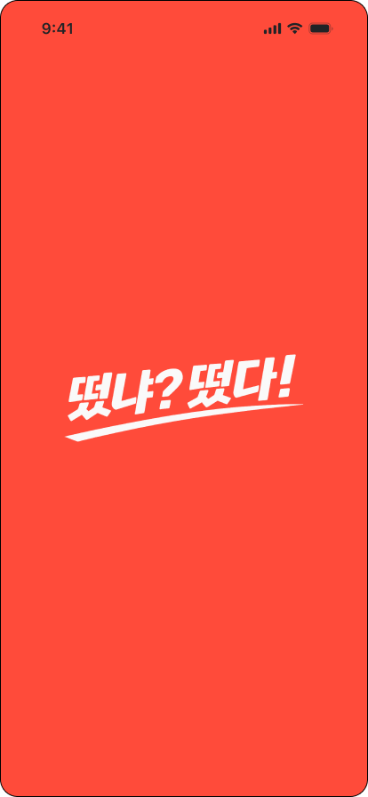
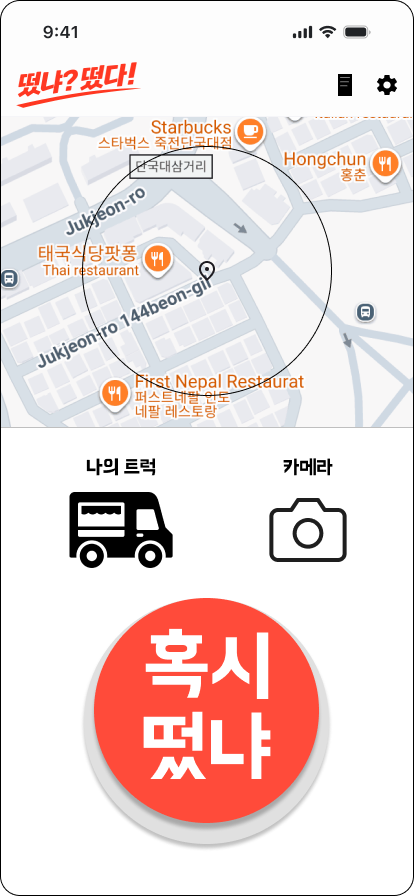
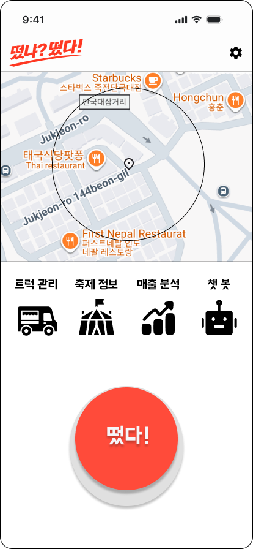
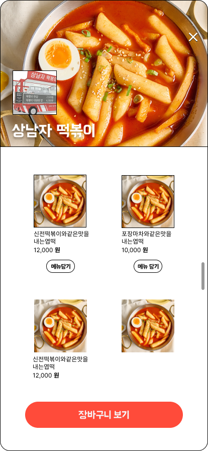
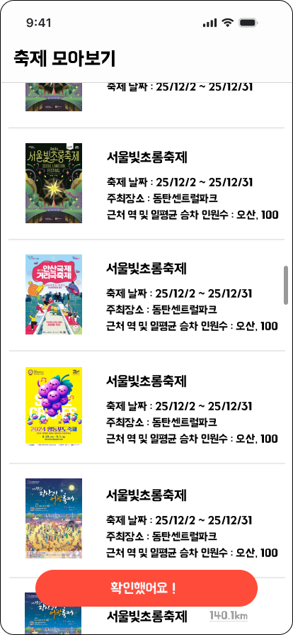
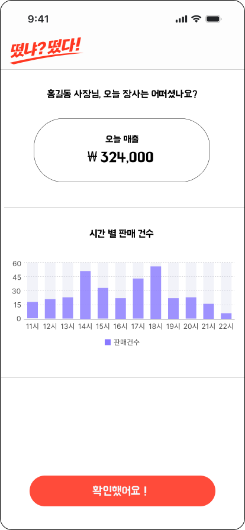
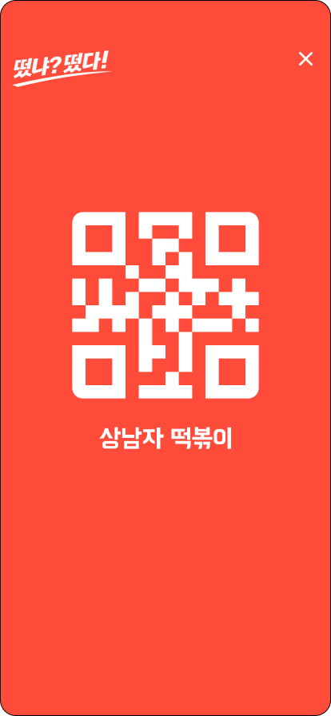
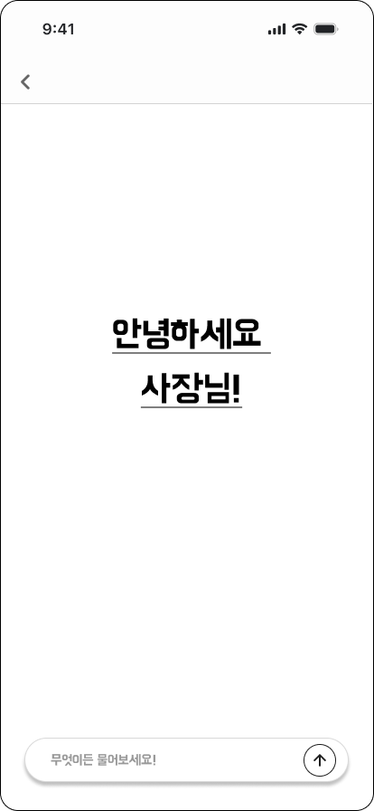

# 🚚 떴냐? 떴다!

### 푸드트럭과 손님을 잇는 실시간 영업 알림 플랫폼

**"오늘 푸드트럭 어디 떴냐? 여기 떴다!"**

푸드트럭의 위치와 영업 소식을 실시간으로 공유하고,  
데이터 기반의 영업 추천으로 사장님의 새로운 기회를 연결합니다.

 

 

---

## 🍀 About 떴냐? 떴다!

**찾아다니는 푸드트럭에서, 서로를 찾아주는 푸드트럭으로.**

푸드트럭은 고정된 매장이 없어 손님에게 현재 영업 위치를 알리기 어렵고, 손님 역시 원하는 푸드트럭이 어디에서 영업 중인지 쉽게 확인하기 어렵습니다.

**떴냐? 떴다!** 는 이러한 불편을 해결하기 위해 탄생한 위치 기반 푸드트럭 플랫폼입니다.

사장님은 '떴다!' 버튼 하나로 주변 고객에게 영업 소식을 알리고, 손님은 '떴냐!'를 통해 근처 푸드트럭을 발견할 수 있습니다.

나아가 지역 축제와 상권 데이터를 활용해 더 나은 영업 기회를 제안합니다.

 

## 📱 Service Preview

### 푸드트럭과 손님을 연결하는 공간

 

<table>
  <tr>
    <td align="center"><b>시작 화면</b></td>
    <td align="center"><b>손님 메인</b></td>
    <td align="center"><b>사장님 메인</b></td>
    <td align="center"><b>메뉴 조회</b></td>
  </tr>
  <tr>
    <td></td>
    <td></td>
    <td></td>
    <td></td>
  </tr>
  <tr>
    <td align="center">서비스 시작</td>
    <td align="center">주변 트럭 탐색</td>
    <td align="center">실시간 영업 관리</td>
    <td align="center">메뉴 확인 및 주문</td>
  </tr>
</table>

 

<table>
  <tr>
    <td align="center"><b>축제 정보</b></td>
    <td align="center"><b>매출 분석</b></td>
    <td align="center"><b>QR 관리</b></td>
    <td align="center"><b>AI 챗봇</b></td>
  </tr>
  <tr>
    <td></td>
    <td></td>
    <td></td>
    <td></td>
  </tr>
  <tr>
    <td align="center">지역 축제 탐색</td>
    <td align="center">영업 데이터 분석</td>
    <td align="center">트럭 QR 조회</td>
    <td align="center">AI 영업 도우미</td>
  </tr>
</table>

 

<!--
## 🎬 Demo Video

 

<a href="시연영상_URL"><b>▶ 서비스 시연 영상 보러 가기</b></a>

 
-->

## ✨ Key Features

| 기능 | 설명 |
|:---|:---|
| 📍 **실시간 영업 알림** | '떴다!' 버튼으로 영업을 시작하고 주변 고객에게 영업 소식을 전달합니다. |
| 🗺️ **위치 기반 트럭 탐색** | 지도에서 주변 푸드트럭의 위치와 영업 상태를 확인합니다. |
| 🍽️ **메뉴 및 주문 관리** | 트럭별 메뉴와 가격을 확인하고 주문할 수 있습니다. |
| 🎪 **지역 축제 정보** | 지역별 축제 및 행사 정보를 제공하여 새로운 영업 기회를 탐색합니다. |
| 📊 **매출 분석** | 일별 매출과 시간대별 판매 건수를 시각화합니다. |
| 📱 **QR 기반 트럭 관리** | 트럭별 QR 코드를 통해 메뉴 조회와 주문 접근을 지원합니다. |
| 🤖 **AI 영업 도우미** | 영업 위치, 지역 행사, 홍보 문구 등 사장님을 위한 AI 기반 영업 지원을 제공합니다. |

 

## 🛠 Tech Stack

### Frontend

### Backend

### Database & Infrastructure

### AI & Data

 

## 🏆 Awards & Achievements

### 🥉 2025 기업데이터 활용 AI 경진대회

**우수상 (IT대학장상)**

2026.01.06

 

## 👥 Our Team

### Team FOOD2LUCK

**더 많은 만남과 새로운 영업 기회를 만들어갑니다.**

 

<table>
  <tr>
    <th align="center">Role</th>
    <th align="center">GitHub</th>
  </tr>
  <tr>
    <td align="center">Backend · AI & Data</td>
    <td align="center">
      <a href="https://github.com/chae-ring">@chae-ring</a>
    </td>
  </tr>
  <tr>
    <td align="center">Frontend</td>
    <td align="center">
      <a href="https://github.com/gaepodongmin">@gaepodongmin</a>
    </td>
  </tr>
  <tr>
    <td align="center">Frontend</td>
    <td align="center">
      <a href="https://github.com/hyoddi">@hyoddi</a>
    </td>
  </tr>
  <tr>
    <td align="center">Backend · Presentation</td>
    <td align="center">
      <a href="https://github.com/Novice-Dev-Robin">@Novice-Dev-Robin</a>
    </td>
  </tr>
</table>

 

---

### 🚚 떴냐? 떴다!

**오늘도 새로운 만남이 뜹니다! 🍀**

Made by **Team FOOD2LUCK**

